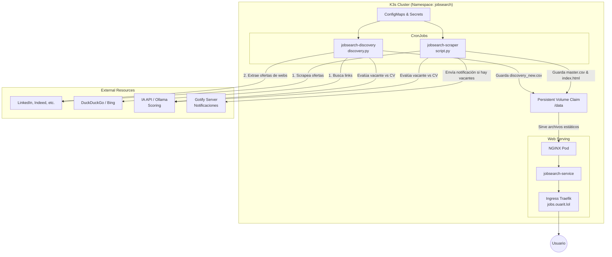

# Arquitectura de JobSearch

El proyecto `jobsearch` está diseñado para correr de forma autónoma en un clúster Kubernetes (k3s), buscando vacantes de forma programada, filtrándolas mediante reglas estáticas e Inteligencia Artificial, y presentando los resultados en un dashboard web.

A continuación se presenta el diagrama general de la arquitectura:

## Componentes y Archivos del Proyecto

### 1. Scripts de Ejecución (Python)

*   **`script.py`**: Es el motor principal del proyecto (ejecutado por el CronJob `jobsearch-scraper`). 
    *   **¿Para qué sirve?**: Utiliza la librería `JobSpy` para hacer scraping en portales de empleo tradicionales (LinkedIn, Indeed, etc.).
    *   **¿Cómo funciona?**: Ejecuta búsquedas basadas en palabras clave (ej. "DevOps"), aplica filtros estáticos (descarta títulos con "Senior", exige palabras como "Kubernetes"), y luego envía las vacantes resultantes junto con tu CV a una API de Inteligencia Artificial para obtener un porcentaje de afinidad (*Match Score*). Finalmente, consolida los resultados, genera el archivo `index.html` estático y envía una notificación a Gotify si hay vacantes nuevas.
*   **`discovery.py`**: Es un motor secundario de descubrimiento web (ejecutado por el CronJob `jobsearch-discovery`).
    *   **¿Para qué sirve?**: Busca vacantes "escondidas" o publicadas directamente en las páginas de las empresas, usando motores de búsqueda (DuckDuckGo, Bing).
    *   **¿Cómo funciona?**: Ejecuta *dorks* de búsqueda para encontrar páginas de *careers* o posts de ofertas, accede a la URL, extrae el texto puro de la web y le pide a la IA que lea el texto e identifique si hay alguna vacante, evaluándola de paso contra el CV. Guarda los resultados en `discovery_new.csv`, los cuales son posteriormente absorbidos por `script.py` y unificados en el dashboard principal.
*   **`deploy.py`**: Es un script utilitario local para facilitar el despliegue.
    *   **¿Para qué sirve?**: Genera dinámicamente los manifiestos de Kubernetes (`ConfigMaps`, `Secrets`, etc.) combinando el código fuente y las variables de entorno.
    *   **¿Cómo funciona?**: Lee el `.env`, `script.py`, `discovery.py`, y `cv.txt` y los inyecta en archivos YAML dentro de la carpeta `manifests/`. Además, si tienes instalado `kubeseal`, encripta los secretos automáticamente antes de aplicar todo al clúster mediante `kubectl apply -k`.

### 2. Archivos de Configuración Local

*   **`.env`** (y `.env.template`): Contiene las variables de entorno sensibles y de configuración general (Tokens de API, URLs, credenciales de Cloudflare, configuración de los CronJobs).
*   **`cv.txt`**: Archivo de texto plano donde debes pegar el contenido de tu Currículum Vitae. Es leído por los scripts de Python y enviado a la IA para evaluar si tu perfil encaja con las vacantes encontradas.

### 3. Infraestructura y Manifiestos (Carpeta `manifests/`)

La carpeta `manifests` es procesada por Kustomize e incluye la declaración de toda la infraestructura dentro de Kubernetes:

*   **`01-namespace-pvc.yaml`**: Crea el namespace `jobsearch` y un Persistent Volume Claim (PVC) de 1Gi. Este volumen es el "disco duro" compartido donde se guarda el historial (`master.csv`, `seen.json`, etc.) y el `index.html`.
*   **`02-configmap-*.yaml`**: (Generados por `deploy.py`) Inyectan el código de los scripts de Python y las configuraciones no sensibles dentro de los Pods.
*   **`03-cronjob.yaml` & `03b-cronjob-discovery.yaml`**: Configuran la ejecución programada de `script.py` y `discovery.py`. Definen los recursos (CPU/RAM) y montan los volúmenes y variables de entorno.
*   **`04-nginx.yaml`**: Levanta un Pod super ligero con NGINX que monta el PVC en modo solo lectura (`ReadOnlyMany`) y sirve la carpeta por el puerto 80. También incluye el `Service` e `IngressRoute` (Traefik) para exponer el dashboard en `jobs.ouarit.lol`.
*   **`06-secret-env-sealed.yaml`**: (Generado por `deploy.py`) Contiene los secretos encriptados con Sealed Secrets de Bitnami (o en texto plano como Secret genérico si no se usa kubeseal).

## Flujo de Datos Principal

1. **Recolección**: Cada cierto tiempo (definido por el cron), `script.py` arranca y busca en JobSpy, mientras que `discovery.py` arranca en un horario distinto y busca mediante Bing/DDG.
2. **Evaluación (IA)**: Las vacantes que pasan el primer filtro básico se envían a la IA (junto con el `cv.txt`) para que evalúe si haces match con los requerimientos.
3. **Consolidación**: `script.py` lee lo que dejó `discovery.py`, junta todo en una base de datos histórica (`master.csv`), y genera la interfaz web (`index.html`).
4. **Notificación**: Si `script.py` detectó que hay vacantes completamente nuevas (no vistas antes), hace una petición POST a tu servidor Gotify.
5. **Consumo**: El usuario (tú) entra a `jobs.ouarit.lol` y NGINX sirve el HTML y los assets directamente desde el volumen persistente.
