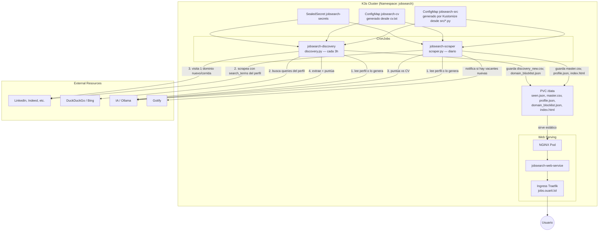

# Arquitectura de JobSearch (v2)

Este proyecto corre de forma autónoma en k3s. Busca vacantes de forma
programada, las evalúa contra tu CV con IA, y presenta los resultados en un
dashboard. La diferencia clave frente a la v1: **tú ya no mantienes listas de
keywords ni de empresas a mano** — todo eso se deriva de tu CV.

## Qué cambió respecto a la v1

| Antes (v1) | Ahora (v2) | Por qué |
|---|---|---|
| `SEARCH_TERMS`, `REQUIRE_ANY_KEYWORDS`, `EXCLUDE_TITLE_KEYWORDS` en `.env` | `profile.json` generado por IA leyendo `cv.txt` | Definir keywords a mano es propenso a error humano; la IA infiere del CV real. |
| `deploy.py` generando manifiestos dinámicamente | `configMapGenerator` de Kustomize | Una sola fuente de verdad; edita `src/*.py` y el siguiente `apply` ya lo refleja. |
| Filtro binario por keyword en el título | Filtro por `match_score` (umbral `MIN_MATCH_SCORE`) | El juicio de "esto encaja con mi perfil" lo hace la IA sobre contenido completo, no un match de substring en el título. |
| Discovery: hasta 10 dominios nuevos/corrida, sin blocklist por dominio | 1 dominio nuevo/corrida, `domain_blocklist.json` con `avoid=true` tras 2 strikes | Bajo perfil real — un bloqueo dos veces significa "no insistas ahí". |
| CV en LaTeX crudo mandado a la IA | `cv_extract.py` limpia el LaTeX antes de cualquier prompt, cacheado en `/data/cv_clean.txt` | Menos ruido en el prompt, mejor scoring. |

## Componentes

### `src/common.py`
Todo lo compartido: config desde variables de entorno, cliente de IA,
`ensure_profile()` (genera/cachea el perfil de búsqueda desde el CV,
detectando cambios por hash), blocklist de dominios, fetch respetuoso de
`robots.txt`, notificación a Gotify.

### `src/cv_extract.py`
Convierte el CV en LaTeX a texto plano legible. Heurístico dirigido a los
comandos típicos de plantillas de CV (`\textbf`, `\item`, `\section*`,
`\href`, `\hfill`, etc.), no un compilador LaTeX completo.

### `src/scraper.py` (CronJob `jobsearch-scraper`, diario)
1. Asegura que exista un perfil vigente (`common.ensure_profile`).
2. Scrapea con JobSpy usando los `search_terms` del perfil.
3. Filtra por ubicación/remoto (estructural, no de contenido).
4. Puntúa cada vacante nueva contra el CV con IA.
5. Descarta lo que no llegue a `MIN_MATCH_SCORE`.
6. Absorbe lo que dejó `discovery.py` en `discovery_new.csv`.
7. Regenera `master.csv` e `index.html`, notifica a Gotify si hay novedades.

### `src/discovery.py` (CronJob `jobsearch-discovery`, cada 3h)
1. Asegura perfil vigente (igual que el scraper, por si corre primero).
2. Arma queries de búsqueda desde `profile.company_search_queries`.
3. Busca en DuckDuckGo/Bing (con backoff si el motor te bloquea).
4. Descarta dominios ya marcados `avoid=true`.
5. Visita **como máximo un dominio nuevo** por corrida, con jitter.
6. Si el dominio responde 403/429/captcha, registra un strike; al segundo,
   lo marca para evitarse permanentemente.
7. Si el contenido cambió (hash), le pide a la IA que extraiga y puntúe
   vacantes, y las guarda en `discovery_new.csv` para que el scraper las
   absorba en su siguiente corrida.

## Despliegue

Todo vive en `kustomization.yaml` en la raíz — `kubectl apply -k .` desde
la carpeta del proyecto. Ver `README.md` para el detalle de sellado de
secretos.
